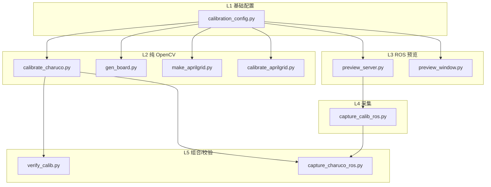

# 初步阐述该模块

## 简述

本模块用于在ubuntu20-ros1环境下完成标定工作。

主要功能：
- 生成ChArUco标定板
- 在线预览角点解算状态
- 保存图片
- 离线标定

## 依赖
系统：ubuntu20

其他依赖：
- ros1

apt依赖：
- ros-noetic-cv-bridge
- libfreetype6-dev（可选）

pip依赖：
- numpy
- opencv-python
- pyyaml
- reportlab
  
## 环境校验
下列指令校验完整性
```bash
bash -c '
source /opt/ros/noetic/setup.bash || {
    echo "[FAIL] source ROS"
    exit 1
}
fail=0
chk() {
    local name="$1"
    local cmd="$2"
    if eval "$cmd" >/tmp/chk.out 2>&1; then
        echo "[OK]   $name"
    else
        echo "[FAIL] $name"
        sed "s/^/       /" /tmp/chk.out
        fail=1
    fi
}
chk_optional() {
    local name="$1"
    local cmd="$2"
    if eval "$cmd" >/tmp/chk.out 2>&1; then
        echo "[OK]   $name"
    else
        echo "[SKIP] $name（可选，忽略）"
    fi
}
chk "ROS master/roscore" "rosnode list >/dev/null 2>&1 || (timeout 8s roscore >/tmp/roscore.log 2>&1; grep -q \"started core service\" /tmp/roscore.log)"
chk "rospy" "python3 -c \"import rospy\""
chk "sensor_msgs" "rosmsg list | grep -q sensor_msgs"
chk "cv_bridge" "python3 -c \"from cv_bridge.boost.cv_bridge_boost import getCvType\""
chk "cv2" "python3 -c \"import cv2\""
chk "numpy" "python3 -c \"import numpy\""
chk "yaml" "python3 -c \"import yaml\""
chk "reportlab" "python3 -c \"from reportlab.lib.pagesizes import A4\""
chk "pip" "python3 -m pip --version"
chk_optional "freetype2" "pkg-config --modversion freetype2"
exit $fail
'
```

## 各脚本关系

脚本之间为**单向依赖**（有向无环图，DAG），自底向上共 5 层；最底层为上一节的"环境依赖"。脚本不互相循环引用，可据此按拓扑序逐个移植与测试。

### 依赖关系



### 关键点

1. **依赖 ROS（`rospy`/`sensor_msgs`/`cv_bridge`）的只有 L3/L4 三个脚本**：
   `preview_server.py`、`preview_window.py`、`capture_calib_ros.py`；
   其余为纯 OpenCV，与 ROS 版本无关。
2. **L5 脚本依赖 L2/L4**，移植时须在 `calibrate_charuco.py` 与 `capture_calib_ros.py` 之后。
3. **移植顺序即拓扑序**：L1 → L2 → L3 → L4 → L5。

## 脚本功能与使用方式

### 通用命令行参数

所有脚本由 `calibration_config.py` 的 `parse_tool_args` 提供以下通用参数：

| 参数 | 作用 |
| --- | --- |
| `--config 文件` | 使用外部 YAML 配置（默认读 `config/camera.yaml`） |
| `--print-config` | 打印生效参数后退出，不执行任何采集/求解 |
| `--test` | 运行脚本内部函数自测（不依赖相机、图片数据） |

---

### calibration_config.py（L1 基础配置模块）

**功能**：共用配置加载（YAML → argparse 默认值）+ 8 个 OpenCV 新旧 API 兼容函数。

**命令参数**：
```bash
python3 calibration_config.py --test   # 自测（校验 _read/_get/_merge/兼容函数/load_settings）
```

**第三方调用**：
```python
from calibration_config import parse_tool_args, load_settings, detector_parameters
from calibration_config import (aruco_dict, charuco_board, detect_markers,
                                draw_marker, draw_board, interpolate_charuco,
                                chessboard_corners)
```

---

### calibrate_charuco.py（L2 ChArUco 内参求解，推荐）

**功能**：用 ChArUco 标定板照片求解相机内参（fx, fy, cx, cy + radtan 畸变，固定 k3=0）。

**命令参数**：
```bash
python3 calibrate_charuco.py --images <图片目录> --out <输出目录>
python3 calibrate_charuco.py --images data/calib_charuco/images --out data/calib_charuco
python3 calibrate_charuco.py --test   # 自测（build_board / detect_charuco）
```

**输出**：`calib_result.yaml`（内参+RMS）、`camera_openvins.yaml`（OpenVINS 片段）、`undistort_check.png`。

**第三方调用**：
```python
from calibrate_charuco import build_board, detect_charuco, collect
```

---

### gen_board.py（L2 标定板生成）

**功能**：生成 ChArUco（推荐）+ 棋盘格（备用）标定板 PDF/PNG，按真实毫米尺寸绘制，底部含 100mm 校验尺（打印后量尺验证 1:1）。

**命令参数**：
```bash
python3 gen_board.py                    # 生成到默认目录
python3 gen_board.py --out data/boards  # 指定输出目录
python3 gen_board.py --dpi 600          # 指定渲染 DPI
python3 gen_board.py --test             # 自测（_mm2px / make_charuco / make_checkerboard）
```

**第三方调用**：
```python
from gen_board import make_charuco, make_checkerboard
```

---

### make_aprilgrid.py（L2 AprilGrid 标定板生成）

**功能**：生成 AprilGrid 标定板 PDF（矢量绘制，精确尺寸），内置渲染自检（检测标记数量）。

**命令参数**：
```bash
python3 make_aprilgrid.py --out aprilgrid.pdf   # 生成 + 自检
python3 make_aprilgrid.py --check some.pdf       # 只检查已有 PDF
python3 make_aprilgrid.py --test                 # 自测（marker_matrix / build）
```

**第三方调用**：
```python
from make_aprilgrid import marker_matrix, build, check
```

---

### calibrate_aprilgrid.py（L2 AprilGrid 内参对照）

**功能**：用 AprilGrid 照片求解内参，与 ChArUco 结果交叉对照，含 3 折留出验证（防过拟合）。

**命令参数**：
```bash
python3 calibrate_aprilgrid.py --images <图片目录>
python3 calibrate_aprilgrid.py --images data/images --fast   # 跳过留出验证（慢机器用）
python3 calibrate_aprilgrid.py --test                         # 自测（build_layout）
```

**第三方调用**：
```python
from calibrate_aprilgrid import build_layout, collect
```

---

### preview_server.py（L3 网页预览）

**功能**：网页实时预览（浏览器按需取帧 + AprilGrid 检测叠加 + 九宫格引导）。`--source ros` 订阅话题（标定用，不占相机）；`--source v4l2` 直接抓 `/dev/video0`（GigE 相机不用此模式）。

**命令参数**：
```bash
python3 preview_server.py --source ros --topic /camera/image_raw --port 8099
python3 preview_server.py --no-detect                    # 只看画面，不检测 AprilGrid
python3 preview_server.py --test                         # 自测（_aruco_dict / _detect）
```

**浏览器**：`http://127.0.0.1:8099/`（远程用 `ssh -N -L 8099:127.0.0.1:8099 用户@设备IP`）。

**第三方调用**：
```python
import preview_server as preview   # 复用 Overlay / Handler / render_page 等
```

---

### preview_window.py（L3 窗口预览）

**功能**：本机 X 窗口实时预览（订阅 ROS 话题 + AprilGrid 检测叠加 + 九宫格引导），按 `q`/`ESC` 退出。

**命令参数**：
```bash
python3 preview_window.py --topic /camera/image_raw
python3 preview_window.py --no-detect       # 只看画面
python3 preview_window.py --test            # 自测（aruco_dict / detect）
```

**第三方调用**：
```python
from preview_window import aruco_dict, detect
```

---

### capture_calib_ros.py（L4 AprilGrid 采集框架）

**功能**：订阅 ROS 话题采集 AprilGrid 标定照片，按 3×3 九宫格引导，支持自动（定时）与手动（网页空格/按钮拍照）两种模式。

**命令参数**：
```bash
python3 capture_calib_ros.py --topic /camera/image_raw --out images
python3 capture_calib_ros.py --mode manual --port 8099   # 手动拍照
python3 capture_calib_ros.py --no-preview                # 关闭网页预览
```

**第三方调用**：
```python
from capture_calib_ros import AprilGridDetector, main
```

---

### capture_charuco_ros.py（L5 ChArUco 采集）

**功能**：订阅 ROS 话题采集 ChArUco 标定照片（复用 `capture_calib_ros` 框架，检测器替换为 ChArUco）。

**命令参数**：
```bash
python3 capture_charuco_ros.py              # 按默认配置采集
python3 capture_charuco_ros.py --test       # 自测（CharucoDetector）
```

**第三方调用**：
```python
from capture_charuco_ros import CharucoDetector
```

---

### verify_calib.py（L5 内参校验）

**功能**：单应残差校验内参——比较去畸变前后单应拟合残差，判断畸变系数是否正确（"直线是否被拉直"）。

**命令参数**：
```bash
python3 verify_calib.py --images <图片目录> --calib <标定结果.yaml>
python3 verify_calib.py --images data/calib_charuco/images --calib data/calib_charuco/calib_result.yaml
python3 verify_calib.py --test             # 自测（homography_residual）
```

**第三方调用**：
```python
from verify_calib import homography_residual
```

